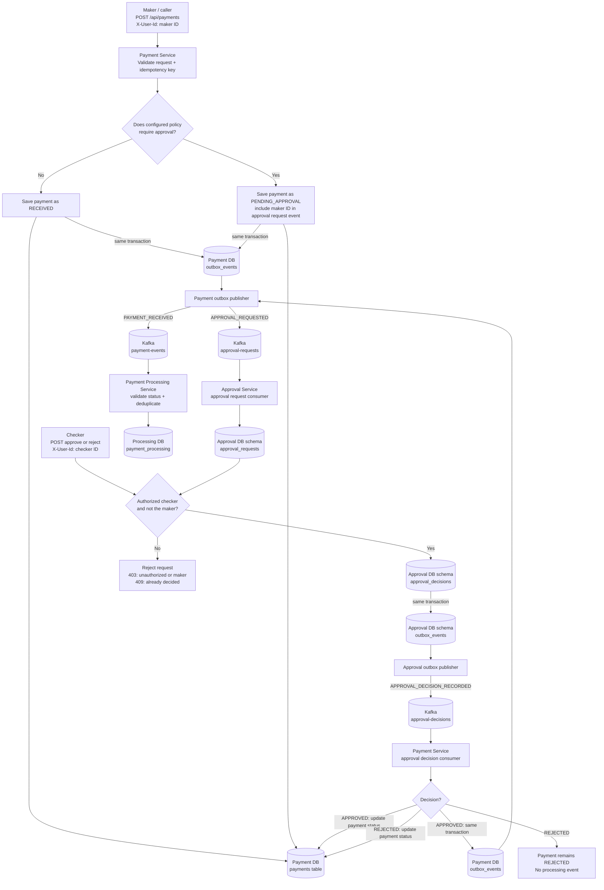

# Maker-checker approval: end-to-end flow

## The short version

1. **Payment Service** creates the payment and chooses whether it needs approval.
2. If approval is needed, it saves the payment as `PENDING_APPROVAL` and queues an approval request in its database outbox.
3. **Approval Service** receives that request, records it, and waits for a checker.
4. An authorized checker approves or rejects it. Approval Service saves the decision and queues a decision event in its own outbox.
5. Payment Service receives the decision. Only an approval queues the payment for the existing processing flow.

Kafka delivery is asynchronous, so each step may take a short moment to appear in the next service. The outboxes make the database change and event intent part of the same transaction.

## Full flow

### What the arrows mean

- A **same transaction** annotation means the service commits its business row and its outbox record together. It does not synchronously call Kafka inside that business transaction.
- The publishers asynchronously send pending outbox rows to Kafka, then mark them published.
- The approval-request consumer inserts by payment ID only once. Checker decisions lock that approval request and the database allows at most one decision per payment.
- The payment decision consumer only changes a payment that is still `PENDING_APPROVAL`. A duplicate or late decision cannot create another transition or processing event.
- The processing consumer only processes `RECEIVED` or `APPROVED` events. It ignores pending/invalid statuses and duplicate payment IDs.

## Payment status versus processing status

These are separate records owned by separate services:

```mermaid
stateDiagram-v2
    state "Payment Service: payments.status" as Payment {
        [*] --> RECEIVED: policy says no approval
        [*] --> PENDING_APPROVAL: policy requires approval
        PENDING_APPROVAL --> APPROVED: authorized checker approves
        PENDING_APPROVAL --> REJECTED: authorized checker rejects
        APPROVED --> [*]: approval decision recorded
        REJECTED --> [*]: terminal; no resubmission flow
        RECEIVED --> [*]: payment event queued
    }

    state "Processing Service: payment_processing.status" as Processing {
        [*] --> PROCESSING: receives eligible payment event
        PROCESSING --> PUBLISHED: processing result event published
    }
```

`PUBLISHED` above is the processing service's record status; Payment Service does not currently consume that result to update `payments.status`.

## Policy and local API

- Default assumption: USD amounts greater than or equal to `PAYMENT_APPROVAL_THRESHOLD_USD` (default `1000.00`) require approval. A currency without a configured threshold requires approval.
- Configure checker IDs in `APPROVAL_AUTHORIZED_USERS`, comma-separated. An empty allowlist means nobody can decide an approval.
- Request an approval: `POST /api/payments` with `Idempotency-Key`, `X-User-Id`, and the payment JSON.
- Read approval request: `GET /api/approvals/{paymentId}` on port `8082`.
- Approve or reject: `POST /api/approvals/{paymentId}/approve` or `/reject` on port `8082`, with checker `X-User-Id` and an optional `{"reason":"..."}` body.
- Read the decision: `GET /api/approvals/{paymentId}/decision` on port `8082`.

`X-User-Id` and the allowlist are development identity controls, not production authentication. A request-supplied ID alone must not be treated as verified identity in production.
